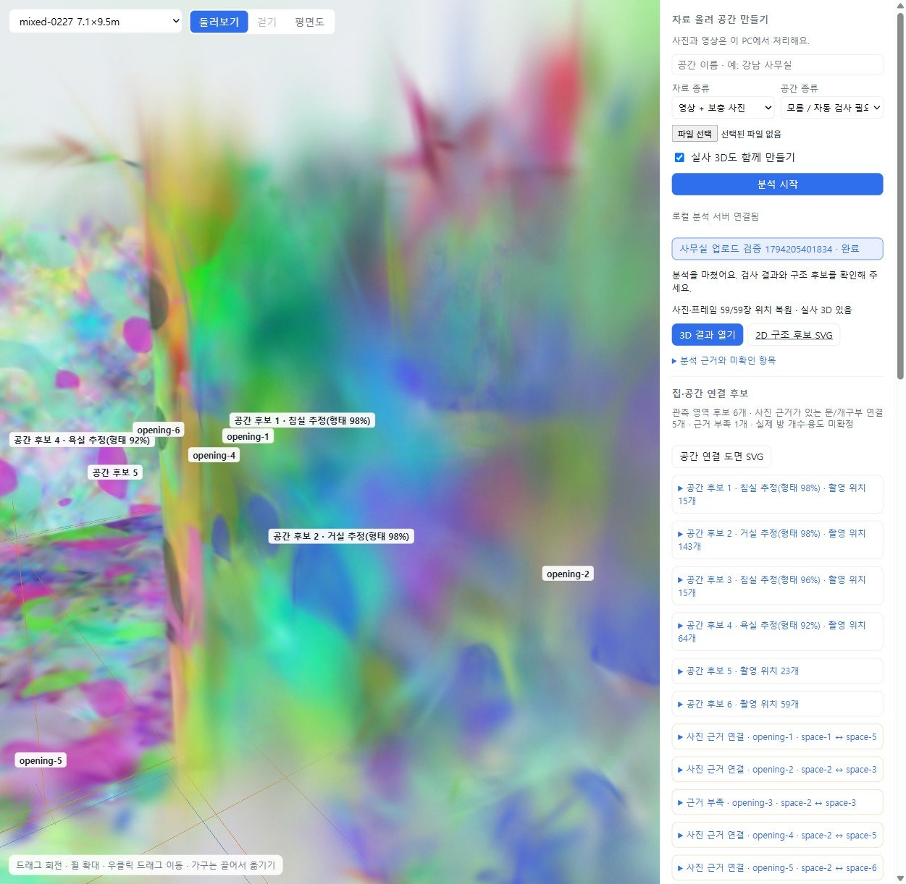
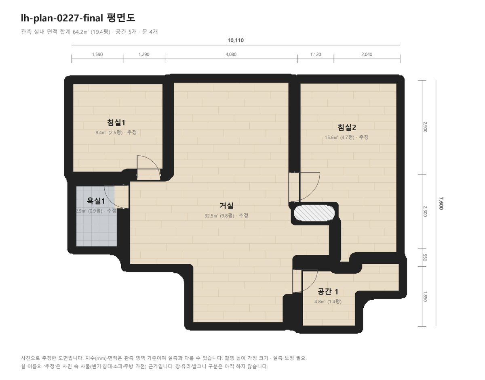
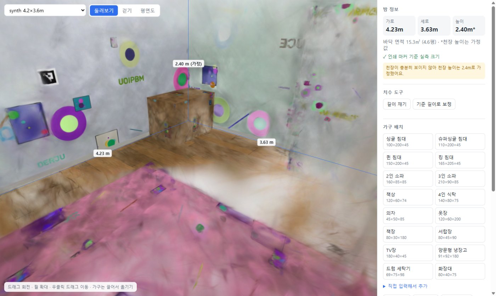
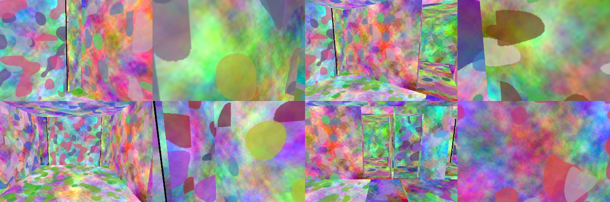
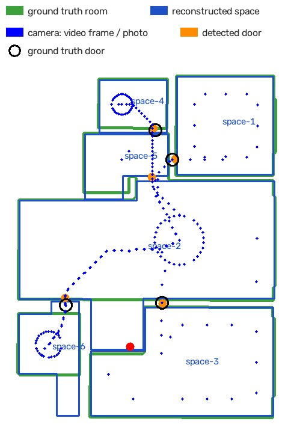
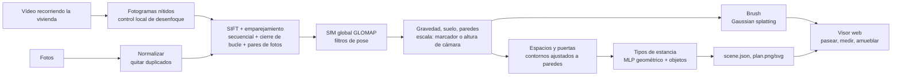

<div align="center">

# spaceCapture

**Recorre una vivienda grabando con el móvil y obtén un espacio 3D medible y un plano 2D.**

[English](README.md) · [한국어](README.ko.md) · [简体中文](README.zh-CN.md) · [日本語](README.ja.md) · **Español**

</div>

> [!IMPORTANT]
> **Prototipo de investigación.** Las cifras de precisión de abajo provienen de dos fuentes, ambas reconstruidas con el pipeline real: renders sintéticos de planos reales de vivienda pública coreana (LH) y un vídeo sintético de una habitación. **Todavía no se ha validado con fotos reales de anuncios ni con vídeos reales de móvil.** Los resultados son candidatos para revisión, no planos certificados.



## Qué hace

Igual que un coche construye una imagen 3D de su entorno con sus cámaras, spaceCapture convierte **lo que grabas en interiores** en un espacio 3D que puedes recorrer, medir y amueblar. Todo se ejecuta **en local en un PC normal** (sin CUDA ni APIs de IA externas) y usa solo componentes de código abierto con uso comercial permitido.

- **Tres formas de captura**: un **vídeo** recorriendo la vivienda, varias **fotos** que se solapan, o **vídeo + fotos adicionales** para las estancias o rincones que el vídeo no cubrió. Todo se reconstruye en un único sistema de coordenadas.
- **Posiciones de cámara y 3D disperso**: COLMAP/GLOMAP en CPU, con convergencia automática de la distancia focal y filtros para fotogramas mal registrados.
- **Escala real**: se obtiene con un marcador ArUco impreso. Sin marcador, se asume una altura de cámara de 1,45 m que puedes corregir en el visor con cualquier longitud conocida.
- **Estancias y puertas**: divide el suelo observado en espacios, encuentra las puertas entre ellos y ajusta el contorno de cada espacio a las paredes observadas.
- **Tipo de estancia**: estima salón, dormitorio o baño a partir de la forma y las conexiones, con una pequeña red neuronal entrenada en este proyecto. Si YOLOX detecta objetos (inodoro, cama, sofá, electrodomésticos de cocina), da prioridad a esa evidencia.
- **3D fotorrealista**: Gaussian Splatting con Brush, que funciona en GPU AMD e Intel mediante WebGPU.
- **Plano 2D al estilo inmobiliario coreano** (`plan.png` / `plan.svg`): paredes negras, suelos de madera y baldosa, apertura de puertas, cotas en mm, ㎡ y pyeong (평).
- **Visor web**: modos órbita, paseo y planta, medición entre dos puntos, calibración de escala y 16 muebles predefinidos con ajuste a pared y detección de colisiones.

<table>
<tr>
<td width="50%"><br><sub>Plano 2D generado (espacios, puertas, superficies y nombres de estancia estimados)</sub></td>
<td width="50%"><br><sub>Habitación con Gaussian splatting, medidas y herramientas de muebles</sub></td>
</tr>
<tr>
<td><br><sub>Fotogramas de un vídeo sintético recorriendo toda la vivienda (entrada de prueba)</sub></td>
<td><br><sub>Reconstrucción con vídeo + fotos frente a la referencia: espacios, puertas y cámaras</sub></td>
</tr>
</table>

## Cómo funciona



## Resultados hasta ahora (datos sintéticos)

| Prueba | Resultado |
|---|---|
| Vídeo de una habitación con marcador (4,2 × 3,6 m) | error de ancho/fondo **+2,8 / +3,1 cm**, RMSE de trayectoria ≈ 0,2 cm |
| Vídeo recorriendo toda la vivienda (162 s, 5 estancias) | **465 / 469** fotogramas registrados, error de cámara 0,39 cm |
| Vídeo (3 estancias) + 42 fotos (las otras 2) | **319 / 323** registradas, las 42 fotos en el mismo sistema de coordenadas, error de cámara **0,16 cm**, IoU de espacios 0,733 |
| Fotos de 26 viviendas no vistas en el entrenamiento (estructuras de planos LH) | IoU medio de espacios **0,833**, exhaustividad / precisión de puertas **0,85 / 0,87** |
| Tipo de estancia (salón / dormitorio / baño / otro), 90 espacios | **84 %** de acierto; **92 %** en el 73 % de espacios que etiqueta |
| Detección de objetos en interiores (YOLOX-s, subconjunto interior de COCO) | mAP50 0,649. En un vídeo real de oficina (TUM RGB-D), 36 de 41 objetos a menos de 1 m, mediana 7,3 cm |

Limitaciones conocidas (detalles en [AGENTS.md](AGENTS.md) y [docs/](docs), principalmente en coreano):
- No funciona en tiempo real: tarda 7–11 min por vivienda en la CPU de un portátil.
- Si el techo no se observa bien, se asume una altura de 2,4 m.
- El error de tipo de estancia más frecuente es confundir el baño con un vestidor o un cuarto de servicio.
- Las fotos reales de anuncios suelen ser 5–20 tomas sin solape, lo que no basta para reconstruir.

## Inicio rápido (Windows)

```powershell
python -m venv .venv
.\.venv\Scripts\python.exe -m pip install -r requirements.txt
.\.venv\Scripts\python.exe tools\fetch-binaries.py      # Brush v0.3.0 + YOLOX-s, con hash verificado
cd viewer; npm install; npm run build; cd ..

.\.venv\Scripts\python.exe -m spacecapture serve       # http://127.0.0.1:8765
```

Abre la aplicación web, elige **vídeo**, **fotos** o **vídeo + fotos adicionales** e inicia el análisis. Los archivos no salen de tu PC.

CLI:

```powershell
# vídeo recorriendo la vivienda, con fotos adicionales opcionales
.\.venv\Scripts\python.exe -m spacecapture process casa.mp4 --photos fotos_extra --max-frames 400
# solo fotos
.\.venv\Scripts\python.exe -m spacecapture photos fotos_anuncio --name anuncio
# volver a analizar una escena existente sin repetir el SfM
.\.venv\Scripts\python.exe -m spacecapture inspect anuncio
# imprimir un marcador ArUco de 150 mm para la escala real
.\.venv\Scripts\python.exe -m spacecapture marker
# autoprueba con una habitación sintética de tamaño conocido
.\.venv\Scripts\python.exe -m spacecapture synth
.\.venv\Scripts\python.exe -m spacecapture process samples\synth_room.mp4 --name synth
.\.venv\Scripts\python.exe -m spacecapture evaluate synth
```

Pruebas: `.\.venv\Scripts\python.exe -m unittest discover -s tests`

Requisitos: Python 3.14, Node 24 y una GPU con WebGPU para Brush (sin GPU, usa `--no-splat` para procesar solo en CPU). Desarrollado en Windows 11 con una iGPU AMD Radeon 780M.

## Consejos de captura

- Camina despacio y evita girar sobre ti mismo. Mantén visible la línea entre suelo y pared.
- En cada estancia, da una vuelta mirando a las paredes. Atraviesa las puertas caminando para que ambos lados se solapen.
- ¿Te faltó un rincón o una estancia pequeña? Añade unas cuantas fotos que se solapen y súbelas junto con el vídeo.
- Para la escala real, pega el marcador impreso en una pared y grábalo 2–3 segundos desde varios ángulos.

## Estructura del proyecto

```
spacecapture/   pipeline en Python (CLI: python -m spacecapture)
viewer/         visor web (Vite + three.js + Spark)
tools/          scripts de entrenamiento, evaluación y preparación de datos
models/         modelos pequeños entrenados aquí (MLP en NumPy) + metadatos de YOLOX
tests/          pruebas unitarias
docs/           notas de diseño e informes de evaluación (principalmente en coreano)
AGENTS.md       documento técnico detallado de traspaso (en coreano)
```

## Licencias y datos

- Componentes: COLMAP/GLOMAP (BSD), OpenCV (Apache-2.0), Brush (Apache-2.0), YOLOX (Apache-2.0), three.js y Spark (MIT). Se excluyen deliberadamente modelos y conjuntos de datos no comerciales.
- Pesos entrenados en `models/`:
  - El modelo de techo se entrenó con estructuras de ProcTHOR (Apache-2.0).
  - Los modelos de espacios, fusión de puertas y tipo de estancia se entrenaron con renders de planos públicos de LH (data.go.kr, sin restricción de uso indicada, indicador de derechos de autor "N").
  - Consulta con el proveedor antes de un entrenamiento o uso comercial. Ver [models/NOTICE.txt](models/NOTICE.txt).
- Este repositorio **no** incluye conjuntos de datos de terceros, escenas renderizadas ni registros de experimentos.
- La licencia del código propio de este proyecto aún no se ha elegido. Todos los derechos reservados hasta que se añada una licencia.

## Hoja de ruta

- Probar con vídeos reales de móvil (paredes blancas, cambios de exposición, desenfoque por movimiento) y corregir lo que falle.
- Procesar más rápido y mostrar una vista previa mientras se graba.
- Introducir o estimar la altura del techo y detectar la cocina por separado.
- Tener en cuenta cristales y espejos. Soporte para viviendas de varias plantas.

Se agradecen issues e ideas.
