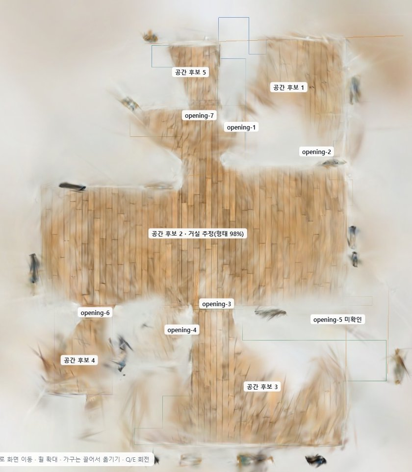
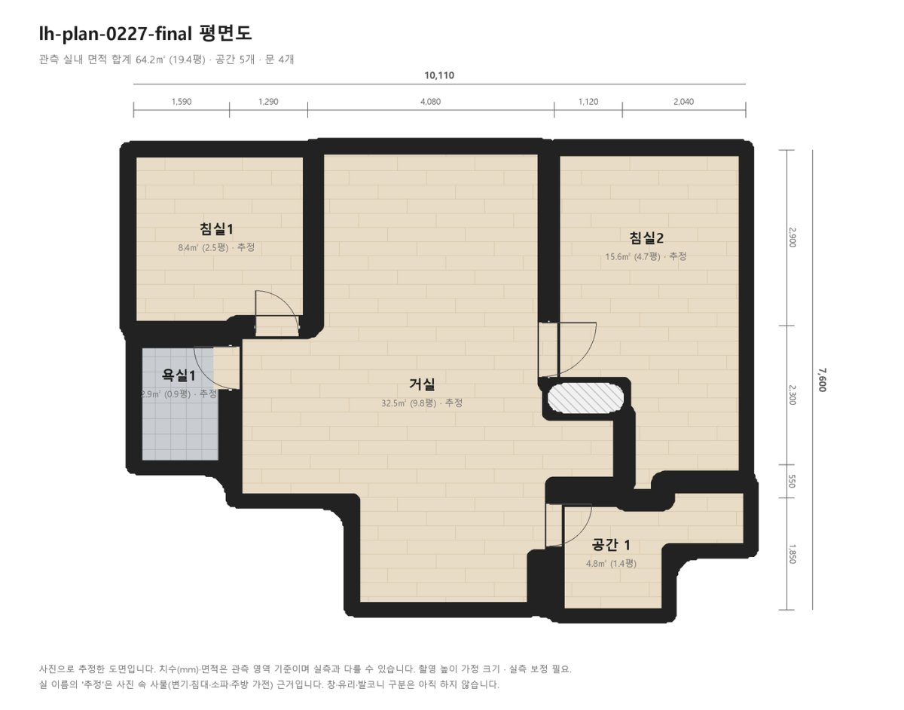
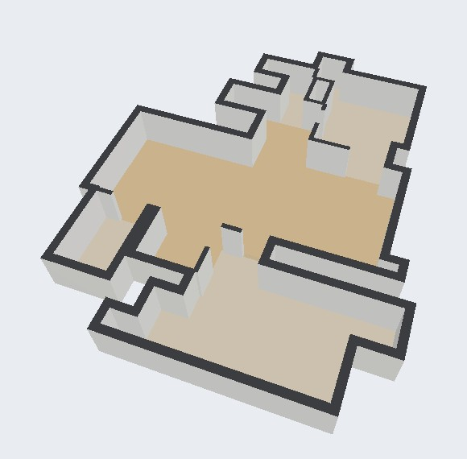
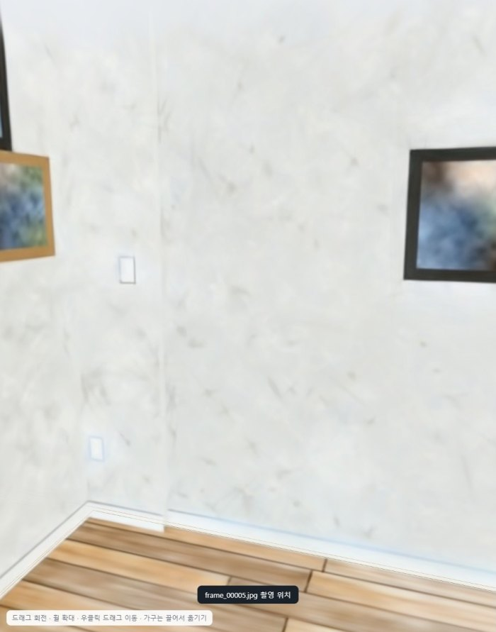
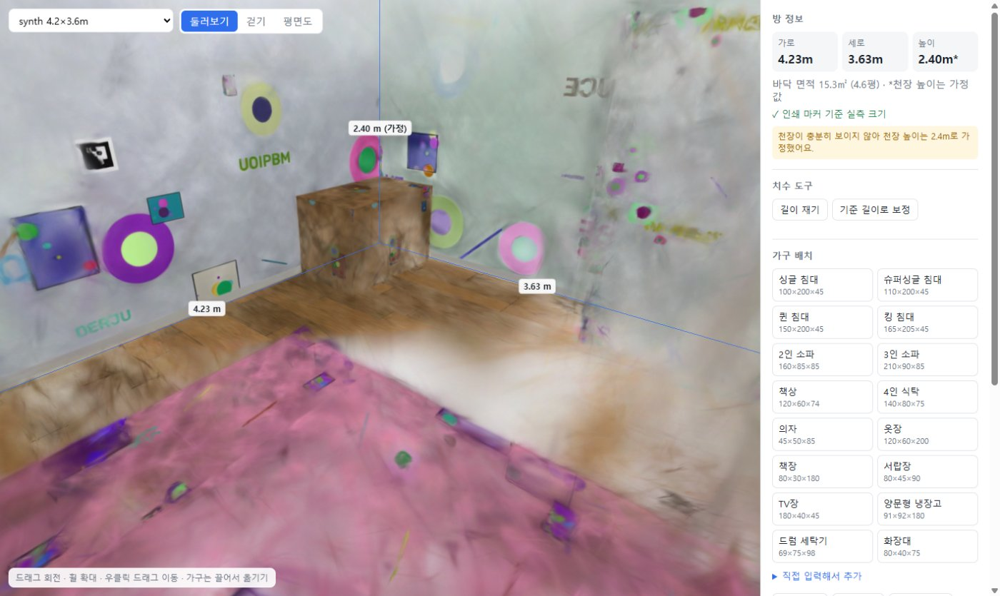
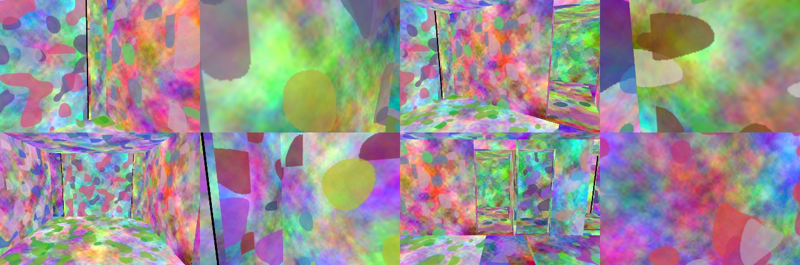
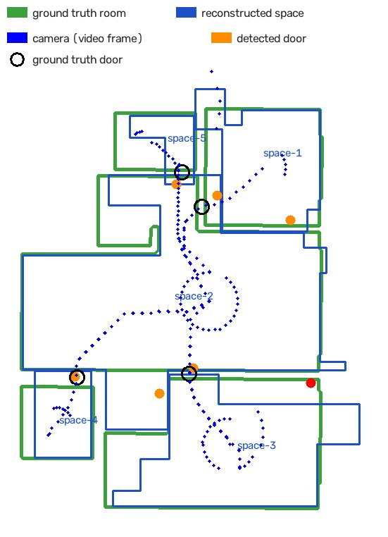
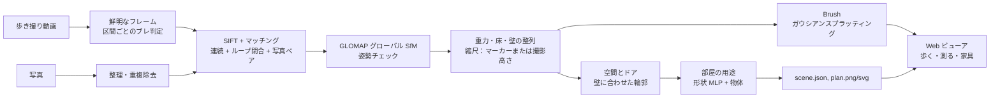

<div align="center">

# spaceCapture

**スマホで家の中を撮りながら歩くだけで —— 寸法を測れる 3D 空間と 2D 間取り図ができます。**

[English](README.md) · [한국어](README.ko.md) · [简体中文](README.zh-CN.md) · **日本語** · [Español](README.es.md)

</div>

> [!IMPORTANT]
> **研究用プロトタイプです。** 以下の精度は、韓国 LH 公共住宅の実際の間取り図構造を自前でレンダリングした合成写真・動画と、合成の部屋動画を、実際のパイプラインで復元した結果です。**実際の物件写真やスマホ動画ではまだ検証していません。** 出力は確認用の候補であり、確定した図面ではありません。



## できること

車がカメラで周囲を 3D に捉えるように、spaceCapture は**室内で撮った動画・写真**を、歩き回り、測り、家具を置いて試せる 3D 空間に変換します。処理はすべて**一般的な PC 上でローカルに**実行され（CUDA や外部 AI API は不要）、商用利用可能なオープンソースのみを使います。

- **3 つの入力方法**：歩きながら撮った**動画**、互いに重なる複数の**写真**、または**動画 + 補足写真**です。動画で撮り漏れた部屋や隅を写真で補えば、すべてを 1 つの座標系で一緒に復元します。
- **カメラ位置と疎な 3D**：CPU で COLMAP/GLOMAP を実行します。焦点距離を自動で収束させ、誤って登録されたフレームは除外します。
- **実寸**：印刷した ArUco マーカーで決めます。マーカーがない場合は撮影高さ 1.45 m を仮定し、ビューアで既知の長さを 1 つ指定して補正できます。
- **部屋とドア**：観測した床を空間に分割し、空間どうしをつなぐ開口部を見つけ、空間の輪郭を観測した壁に合わせます。
- **部屋の用途**：形と接続関係からリビング・寝室・浴室を推定します（このプロジェクトで学習した小さなニューラルネット）。YOLOX でトイレ・ベッド・ソファ・キッチン家電などを検出できた場合は、その根拠を優先します。
- **フォトリアルな 3D**：Brush によるガウシアンスプラッティング。WebGPU 経由で AMD/Intel GPU でも動作します。
- **韓国の不動産サイト風 2D 間取り図**（`plan.png` / `plan.svg`）：黒い壁、木目・タイルの床、ドアの開閉、mm 寸法線、㎡ と坪（평）を描きます。
- **よりきれいな 3D**：動画では模様の少ない白い壁でも特徴点を拾う低コントラスト検出を使い、家の外に浮いたスプラットを自動で除去します。
- **家具のサイズと向き**：認識した家具ごとに、すべての写真の検出枠と合うよう 3D ボックス（幅・奥行き・高さ・向き）を当てはめ、車の走行画面のように整ったモデル（ベッド・ソファ・椅子・テーブル・テレビ・冷蔵庫など）として 3D 構造モデルに描き直し、2D 間取り図にも実寸で描きます。床をベッドと誤認したもの（設置面の内側に床が見える）は除外し、重複は統合します。TUM の実オフィス：上面高さの誤差中央値 9.1 cm（深度カメラ基準）。家具のある写実的なレンダリング住宅（Apple Hypersim、調整に使っていない 15 シーン、正解 3D ボックス）：標準サイズ家具の幅・奥行き誤差 11 cm、高さ 7 cm、向き 3°（中央値）、適合率 0.53、再現率 0.37。
- **整った壁モデル**：すべての部屋を共通の壁線にそろえ、部屋間の細い隙間は実測厚の壁に、外壁は部屋の外側に立て、ドアは壁に開口として抜きます。2D 間取り図（黒い壁・開き戸・正味面積）と 3D 模型（壁を 1.1 m で切断）が同じモデルを使い、部屋の精度は維持しています（LH テスト IoU 0.833 → 0.828、歩き撮り動画 0.698 → 0.703）。
- **構造モデル**：復元した空間から壁とドア開口を立て直したすっきりした模型。部屋名と面積も表示します。
- **Web ビューア**：周回・ウォーク・平面図モード、2 点計測、基準長さによる補正、家具プリセット 16 種（壁へのスナップ・干渉チェック）に対応します。

<table>
<tr>
<td width="50%"><br><sub>生成された 2D 間取り図（空間・ドア・面積・推定した部屋名）</sub></td>
<td width="50%"><br><sub>構造モデル：復元した空間から壁を立ててドア部分を開け、床は用途別に色分け</sub></td>
</tr>
<tr>
<td><br><sub>ガウシアンスプラットで復元した家の室内視点（壁紙・額縁・コンセント・木の床）</sub></td>
<td><br><sub>ガウシアンスプラットの部屋、計測寸法と家具ツール</sub></td>
</tr>
<tr>
<td><br><sub>白い壁紙・木の床の合成歩き撮り動画のフレーム（テスト入力）</sub></td>
<td><br><sub>歩き撮り動画の復元結果と正解の比較：空間・ドア・カメラ経路</sub></td>
</tr>
</table>

## 仕組み



## これまでの結果（合成データ）

| テスト | 結果 |
|---|---|
| マーカーありの単一部屋動画（4.2 × 3.6 m） | 幅・奥行き誤差 **+2.8 / +3.1 cm**、カメラ軌跡 RMSE 約 0.2 cm |
| 家全体の歩き撮り動画（162 秒、5 部屋） | **465 / 469** フレームを登録、カメラ誤差 0.39 cm |
| 同じ家、実際に近い素材（模様の少ない白い壁紙・木の床） | **473 / 477** フレームを登録、カメラ誤差 **0.16 cm**、部屋 5 / 5 対応、空間 IoU 0.713 |
| 同じ家、実際のスマホに近い 30 fps 動画（手ブレ・動きのブレ・自動露出・ノイズ・レンズ歪み） | **727 / 807** フレームを登録、部屋 5 / 5 対応、空間 IoU 0.664 |
| 動画（3 部屋）+ 写真 42 枚（残り 2 部屋） | **319 / 323** 枚を登録、写真 42 枚すべて同じ座標系、カメラ誤差 **0.16 cm**、空間 IoU 0.733 |
| 学習に使っていない 26 戸の写真セット（LH 間取り図の構造） | 平均空間 IoU **0.833**、ドアの再現率 / 適合率 **0.85 / 0.87** |
| 部屋の用途（リビング / 寝室 / 浴室 / その他）、90 空間 | 正解率 **84%**、名前を付けた 73% の空間では **92%** |
| 室内物体検出（YOLOX-s、COCO 室内サブセット） | mAP50 0.649。実際のオフィス動画（TUM RGB-D）では物体 41 個中 36 個が 1 m 以内、中央値 7.3 cm |

既知の課題は次のとおりです。詳細は [AGENTS.md](AGENTS.md) と [docs/](docs)（主に韓国語）をご覧ください。
- リアルタイムではありません。ノート PC の CPU で 1 戸あたり 7〜11 分かかります。
- 天井が十分に観測されない場合、天井高は 2.4 m と仮定します。
- 部屋の用途では、浴室とウォークインクローゼット・ユーティリティの取り違えが最も多い誤りです。
- 実際の物件写真は通常 5〜20 枚で互いに重ならないため、復元の入力としては足りません。

## クイックスタート（Windows）

```powershell
python -m venv .venv
.\.venv\Scripts\python.exe -m pip install -r requirements.txt
.\.venv\Scripts\python.exe tools\fetch-binaries.py      # Brush v0.3.0 + YOLOX-s（ハッシュ検証済み）
cd viewer; npm install; npm run build; cd ..

.\.venv\Scripts\python.exe -m spacecapture serve       # http://127.0.0.1:8765
```

Web アプリで**動画**、**写真**、**動画 + 補足写真**のいずれかを選んで解析を開始します。ファイルはこの PC の外に出ません。

CLI：

```powershell
# 歩き撮り動画（補足写真は任意）
.\.venv\Scripts\python.exe -m spacecapture process home.mp4 --photos extra_photos --max-frames 400
# 写真のみ
.\.venv\Scripts\python.exe -m spacecapture photos listing_photos --name listing
# SfM をやり直さずに既存シーンを再解析
.\.venv\Scripts\python.exe -m spacecapture inspect listing
# 実寸用の 150 mm ArUco マーカーを印刷
.\.venv\Scripts\python.exe -m spacecapture marker
# 寸法が既知の合成部屋でセルフテスト
.\.venv\Scripts\python.exe -m spacecapture synth
.\.venv\Scripts\python.exe -m spacecapture process samples\synth_room.mp4 --name synth
.\.venv\Scripts\python.exe -m spacecapture evaluate synth
```

テスト：`.\.venv\Scripts\python.exe -m unittest discover -s tests`

動作環境：Python 3.14、Node 24、Brush 用に WebGPU 対応 GPU（GPU がなければ `--no-splat` で CPU のみ）。開発環境は Windows 11 + AMD Radeon 780M 内蔵 GPU です。

## 撮影のコツ

- ゆっくり歩き、その場でぐるぐる回る動きは控えてください。床と壁の境目が映るようにします。
- 各部屋では壁を見ながら一周し、ドアは歩いて通り抜けて両側が重なるように撮ります。
- 撮り漏れた隅や小さな部屋は、重なりのある写真を数枚撮って動画と一緒にアップロードしてください。
- 実寸が必要なら、印刷したマーカーを壁に貼り、いくつかの角度から 2〜3 秒ずつ撮ります。

## フォルダ構成

```
spacecapture/   Python パイプライン（CLI：python -m spacecapture）
viewer/         Web ビューア（Vite + three.js + Spark）
tools/          学習・評価・データ準備スクリプト
models/         このプロジェクトで学習した小さなモデル（NumPy MLP）+ YOLOX 情報
tests/          単体テスト
docs/           設計メモと評価レポート（主に韓国語）
AGENTS.md       詳細な引き継ぎ文書（韓国語）
```

## ライセンスとデータ

- 構成要素：COLMAP/GLOMAP（BSD）、OpenCV（Apache-2.0）、Brush（Apache-2.0）、YOLOX（Apache-2.0）、three.js・Spark（MIT）。非商用のモデルやデータセットは意図的に使っていません。
- `models/` の学習済み重み：
  - 天井モデルは ProcTHOR（Apache-2.0）の構造で学習しました。
  - 空間・ドア統合・部屋用途モデルは、LH 公共間取り図（韓国公共データポータル data.go.kr、利用制限の記載なし、著作権確保表示 "N"）をレンダリングしたデータで学習しました。
  - 商用での学習・利用の前には提供機関への確認が必要です。[models/NOTICE.txt](models/NOTICE.txt) を参照してください。
- 外部データセットの原本、レンダリングしたシーン、実験記録はこのリポジトリに**含めていません**。
- このプロジェクトのコードは [MIT ライセンス](LICENSE) です。外部の構成要素と `models/` の学習済み重みに関するデータ上の注意事項は、それぞれの条件に従います。

## ロードマップ

- 実際のスマホ動画（白い壁、露出の変化、手ブレ）でテストし、問題を修正する。
- 処理を高速化し、撮影中のプレビューを表示する。
- 天井高の入力・推定、キッチンの個別認識に対応する。
- ガラス・鏡を認識し、複数階の住宅に対応する。

Issue やアイデアを歓迎します。
