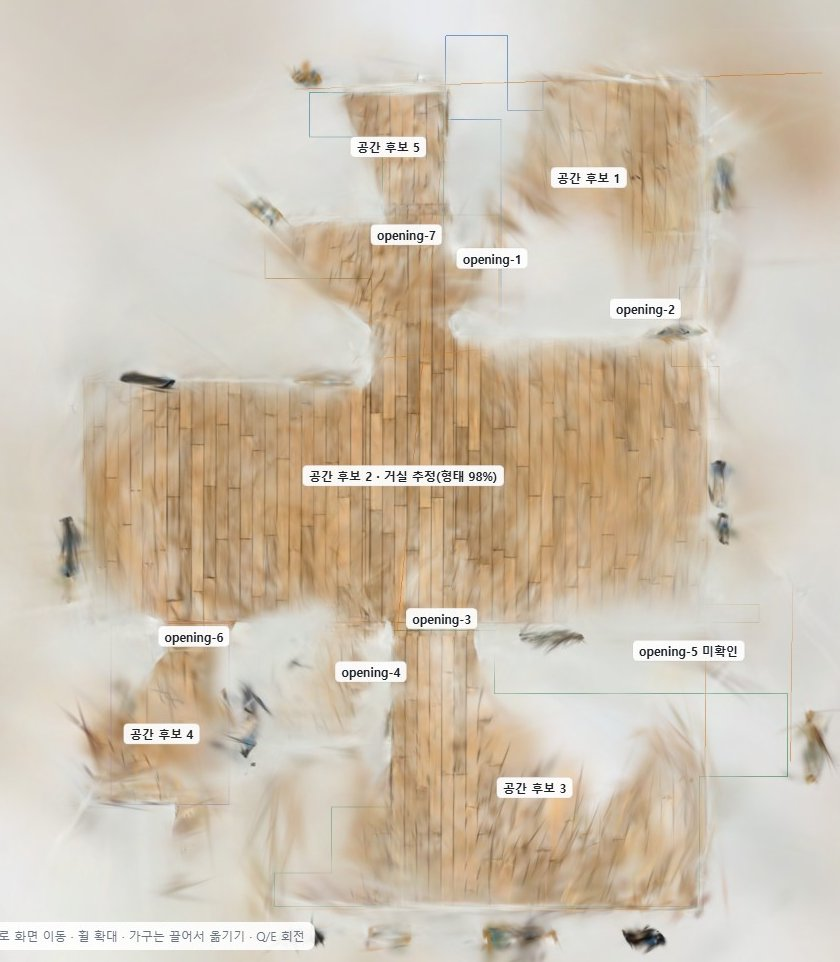
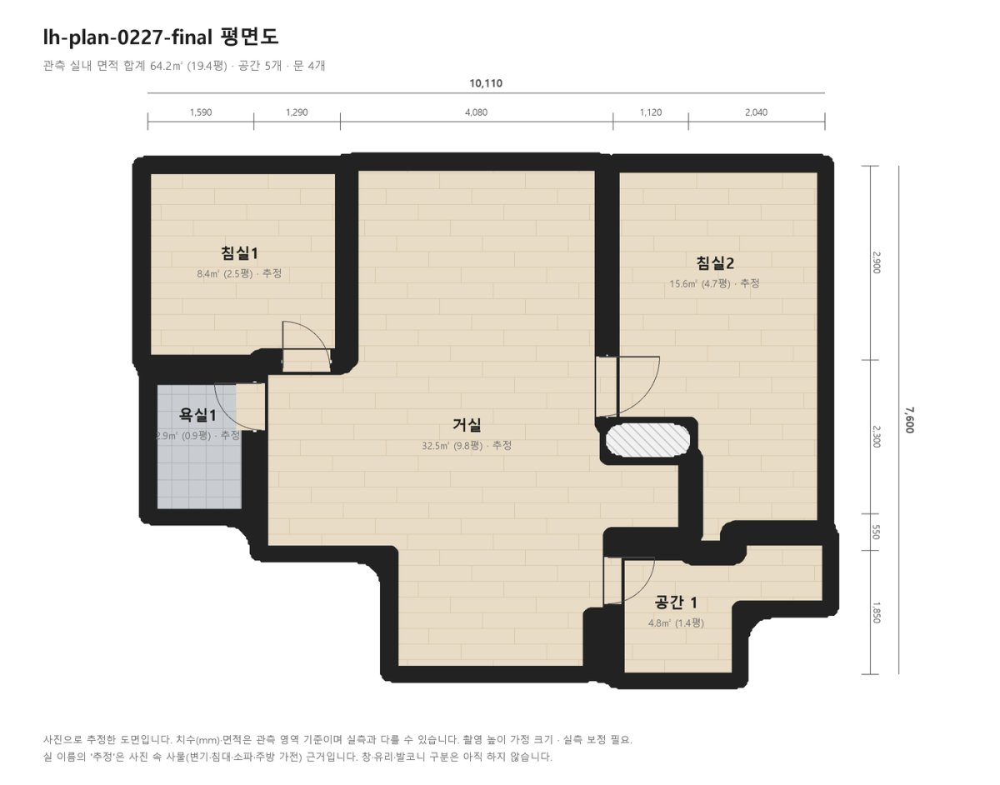
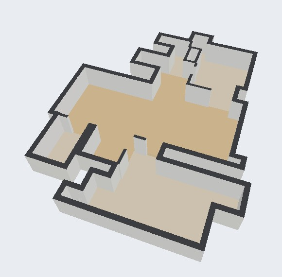
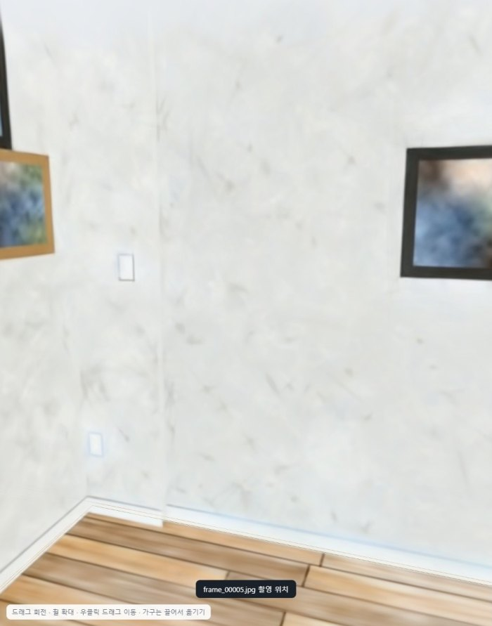
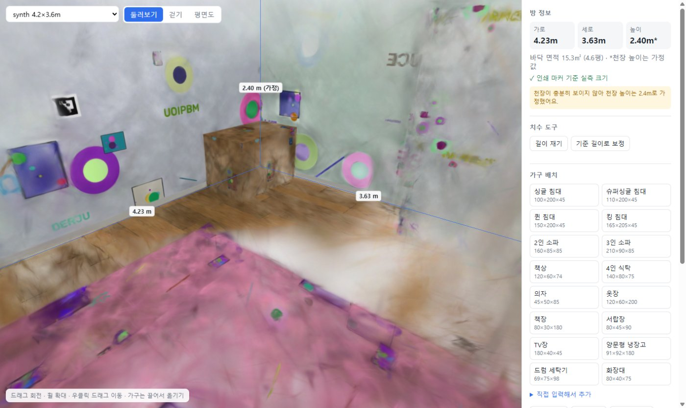
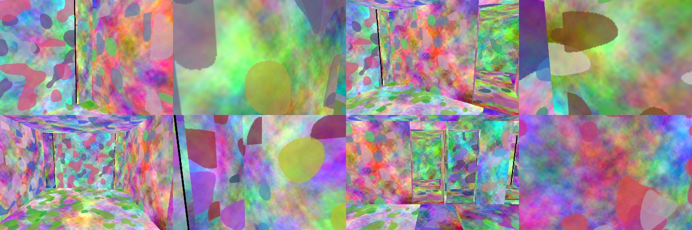
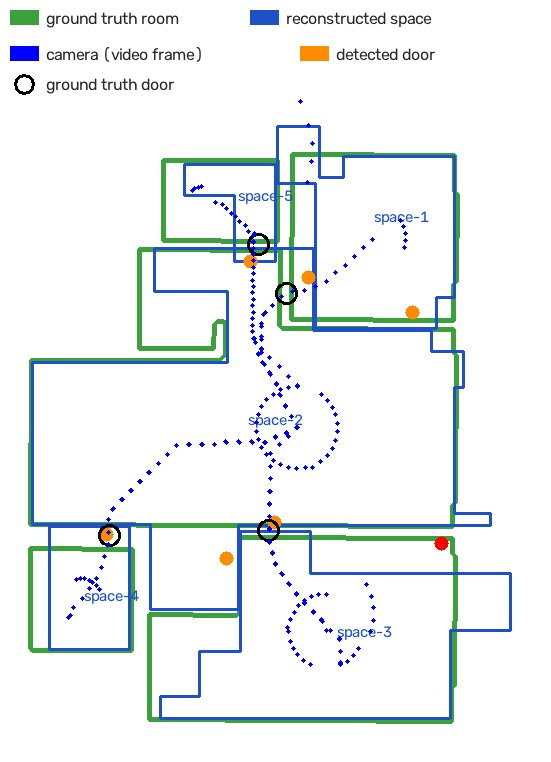
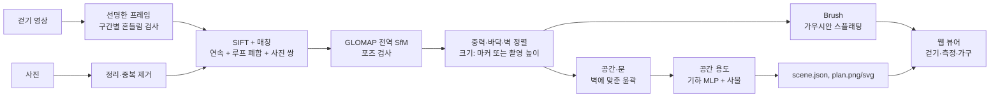

<div align="center">

# spaceCapture

**폰으로 집 안을 찍으며 걸으면 — 치수를 잴 수 있는 3D 공간과 2D 평면도가 나옵니다.**

[English](README.md) · **한국어** · [简体中文](README.zh-CN.md) · [日本語](README.ja.md) · [Español](README.es.md)

</div>

> [!IMPORTANT]
> **연구용 시제품입니다.** 아래 정확도는 국내 LH 공공주택 실제 평면도 구조를 자체 렌더링한 합성 사진·영상과 합성 방 영상을 실제 파이프라인으로 복원한 결과입니다. **실제 매물 사진이나 실제 폰 영상으로는 아직 검증하지 않았습니다.** 결과는 검토용 후보이며, 확정 도면이 아닙니다.



## 무엇을 하나요

자동차가 카메라로 주변을 3D로 그려 내듯, spaceCapture는 **실내에서 찍은 영상·사진**을 걸어 다니고, 재고, 가구를 놓아 볼 수 있는 3D 공간으로 만듭니다. 모든 처리는 **일반 PC에서 로컬로**(CUDA·외부 AI API 없이) 돌아가며, 상업적으로 쓸 수 있는 오픈소스만 사용합니다.

- **세 가지 입력**: 걸으며 찍은 **영상**, 서로 겹치는 **사진** 여러 장, 또는 **영상 + 보충 사진**입니다. 영상에서 빠진 방이나 구석을 사진으로 채우면 하나의 좌표계로 함께 복원합니다.
- **카메라 위치와 3D 점**: CPU에서 COLMAP/GLOMAP을 돌립니다. 초점거리를 자동으로 수렴시키고, 잘못 놓인 프레임은 걸러냅니다.
- **실제 크기**: 인쇄한 ArUco 마커로 맞춥니다. 마커가 없으면 촬영 높이 1.45m를 가정하고, 뷰어에서 아는 길이 하나로 보정할 수 있습니다.
- **방과 문**: 관측된 바닥을 공간으로 나누고, 공간 사이의 문을 찾고, 공간 윤곽을 벽에 맞춥니다.
- **공간 용도**: 크기·모양·연결로 거실·침실·욕실을 추정합니다(직접 학습한 작은 신경망). YOLOX로 검출한 변기·침대·소파·주방 가전 같은 사물 근거가 있으면 그것을 우선합니다.
- **실사 3D**: Brush로 가우시안 스플래팅을 학습합니다. WebGPU로 AMD/Intel GPU에서도 동작합니다.
- **국내 매물 양식 2D 평면도**(`plan.png` / `plan.svg`): 검은 벽, 나무·타일 바닥, 문 열림 표시, mm 치수 사슬, ㎡와 평을 그립니다.
- **더 깨끗한 3D**: 영상의 무늬 없는 흰 벽에서도 특징점을 잡는 저대비 검출, 집 밖에 떠 있는 스플랫 자동 정리.
- **구조 모형**: 복원된 공간으로 벽과 문 자리를 다시 세운 깔끔한 모형 집. 방 이름과 면적을 함께 표시합니다.
- **웹 뷰어**: 둘러보기·걷기·평면도 모드, 두 점 측정, 기준 길이 보정, 가구 16종 배치(벽 스냅·겹침 검사)를 지원합니다.

<table>
<tr>
<td width="50%"><br><sub>생성된 2D 평면도 (공간·문·면적·추정 실 이름)</sub></td>
<td width="50%"><br><sub>구조 모형: 복원된 공간으로 벽을 세우고 문 자리를 비움, 바닥은 용도별 색</sub></td>
</tr>
<tr>
<td><br><sub>가우시안 스플랫으로 만든 집의 실내 시점 (벽지·액자·콘센트·나무 마루)</sub></td>
<td><br><sub>가우시안 스플랫으로 만든 방, 측정 치수와 가구 도구</sub></td>
</tr>
<tr>
<td><br><sub>흰 벽지·나무 마루의 합성 걷기 영상 프레임 (시험 입력)</sub></td>
<td><br><sub>걷기 영상 복원 결과와 정답 비교: 공간·문·카메라 경로</sub></td>
</tr>
</table>

## 동작 방식



## 지금까지의 결과 (합성 자료)

| 시험 | 결과 |
|---|---|
| 마커가 있는 방 하나 영상 (4.2 × 3.6m) | 가로·세로 오차 **+2.8 / +3.1cm**, 카메라 궤적 RMSE 약 0.2cm |
| 집 전체 걷기 영상 (162초, 방 5개) | 프레임 **465 / 469**장 위치 복원, 카메라 오차 0.39cm |
| 같은 집, 실제 같은 재질 (무늬 적은 흰 벽지·나무 마루) | 프레임 **473 / 477**장 위치 복원, 카메라 오차 **0.16cm**, 방 5 / 5 대응, 공간 IoU 0.713 |
| 같은 집, 실제 폰 같은 30fps 영상 (손떨림·흔들림 번짐·자동 노출·노이즈·렌즈 왜곡) | 프레임 **727 / 807**장 위치 복원, 방 5 / 5 대응, 공간 IoU 0.664 |
| 영상(방 3개) + 사진 42장(나머지 방 2개) | **319 / 323**장 복원, 사진 42장 모두 같은 좌표계, 카메라 오차 **0.16cm**, 공간 IoU 0.733 |
| 학습에 쓰지 않은 26채의 사진 묶음 (LH 평면도 구조) | 평균 공간 IoU **0.833**, 문 재현율 / 정밀도 **0.85 / 0.87** |
| 공간 용도 (거실·침실·욕실·기타), 90개 공간 | 정확도 **84%**, 이름을 붙이는 73% 공간에서는 **92%** |
| 실내 사물 검출 (YOLOX-s, COCO 실내 이미지) | mAP50 0.649, 실제 사무실 영상(TUM RGB-D)에서 사물 41개 중 36개가 1m 이내, 중앙값 7.3cm |

알려진 한계는 다음과 같습니다. 자세한 내용은 [AGENTS.md](AGENTS.md)와 [docs/](docs)에 있습니다.
- 실시간이 아닙니다. 노트북 CPU에서 집 한 채에 7~11분 걸립니다.
- 천장이 충분히 보이지 않으면 천장 높이를 2.4m로 가정합니다.
- 공간 용도에서는 욕실과 드레스룸·다용도실을 헷갈리는 경우가 가장 많습니다.
- 실제 매물 사진은 대개 5~20장이고 서로 겹치지 않아 복원 입력으로는 부족합니다.

## 빠른 시작 (Windows)

```powershell
python -m venv .venv
.\.venv\Scripts\python.exe -m pip install -r requirements.txt
.\.venv\Scripts\python.exe tools\fetch-binaries.py      # Brush v0.3.0 + YOLOX-s, 해시 검사
cd viewer; npm install; npm run build; cd ..

.\.venv\Scripts\python.exe -m spacecapture serve       # http://127.0.0.1:8765
```

웹 앱에서 **영상**, **사진**, **영상 + 보충 사진** 중 하나를 고르고 분석을 시작하세요. 파일은 이 PC 밖으로 나가지 않습니다.

CLI:

```powershell
# 걷기 영상 (보충 사진은 선택)
.\.venv\Scripts\python.exe -m spacecapture process 우리집.mp4 --photos 보충사진 --max-frames 400
# 사진만
.\.venv\Scripts\python.exe -m spacecapture photos 매물사진 --name listing
# SfM을 다시 돌리지 않고 기존 장면 재분석
.\.venv\Scripts\python.exe -m spacecapture inspect listing
# 실제 크기용 150mm ArUco 마커 인쇄
.\.venv\Scripts\python.exe -m spacecapture marker
# 크기를 아는 합성 방으로 자체 시험
.\.venv\Scripts\python.exe -m spacecapture synth
.\.venv\Scripts\python.exe -m spacecapture process samples\synth_room.mp4 --name synth
.\.venv\Scripts\python.exe -m spacecapture evaluate synth
```

테스트: `.\.venv\Scripts\python.exe -m unittest discover -s tests`

필요 환경: Python 3.14, Node 24, Brush용 WebGPU 지원 GPU(없으면 `--no-splat`으로 CPU만 사용 가능). Windows 11 + AMD Radeon 780M 내장 GPU에서 개발했습니다. 더 자세한 사용법은 [docs/usage.ko.md](docs/usage.ko.md)에 있습니다.

## 촬영 팁

- 천천히 걷고, 제자리에서 빙글 도는 동작은 줄이세요. 바닥과 벽이 만나는 선이 보이게 찍습니다.
- 방마다 벽을 보며 한 바퀴 돌고, 문은 걸어서 통과해 양쪽이 겹치게 찍습니다.
- 빠뜨린 구석이나 작은 방은 겹치는 사진 몇 장을 찍어 영상과 함께 올리면 됩니다.
- 실제 크기가 필요하면 인쇄한 마커를 벽에 붙이고 2~3초씩 여러 각도에서 찍으세요.

## 폴더 구성

```
spacecapture/   Python 파이프라인 (CLI: python -m spacecapture)
viewer/         웹 뷰어 (Vite + three.js + Spark)
tools/          학습·평가·자료 준비 스크립트
models/         직접 학습한 작은 모델 (NumPy MLP) + YOLOX 정보
tests/          단위 테스트
docs/           설계 기록과 평가 보고서
AGENTS.md       상세 인수인계 문서
```

## 라이선스와 데이터

- 구성 요소: COLMAP/GLOMAP(BSD), OpenCV(Apache-2.0), Brush(Apache-2.0), YOLOX(Apache-2.0), three.js·Spark(MIT). 비상업 모델·데이터는 의도적으로 쓰지 않았습니다.
- `models/`의 학습 가중치:
  - 천장 모델은 ProcTHOR(Apache-2.0) 구조로 학습했습니다.
  - 공간·문 합치기·공간 용도 모델은 LH 공공 평면도(공공데이터포털, 이용허락범위 제한 없음, 저작권 확보 표시 N)를 렌더링한 자료로 학습했습니다.
  - 상업적 학습·사용 전에는 제공기관 확인이 필요합니다. [models/NOTICE.txt](models/NOTICE.txt)를 참고하세요.
- 외부 데이터셋 원본, 렌더링한 장면, 실험 기록은 이 저장소에 **포함하지 않습니다**.
- 이 프로젝트 코드는 [MIT 라이선스](LICENSE)입니다. 외부 구성 요소와 `models/` 학습 가중치의 데이터 관련 주의 사항은 각자의 조건을 따릅니다.

## 앞으로 할 일

- 실제 폰 영상(흰 벽, 노출 변화, 흔들림)으로 시험하고 깨지는 부분을 고칩니다.
- 처리 속도를 높이고, 촬영하는 동안 미리보기를 보여 줍니다.
- 천장 높이 입력·추정, 주방 별도 인식을 추가합니다.
- 유리·거울을 인식하고, 여러 층 집을 지원합니다.

이슈와 아이디어 제안을 환영합니다.
