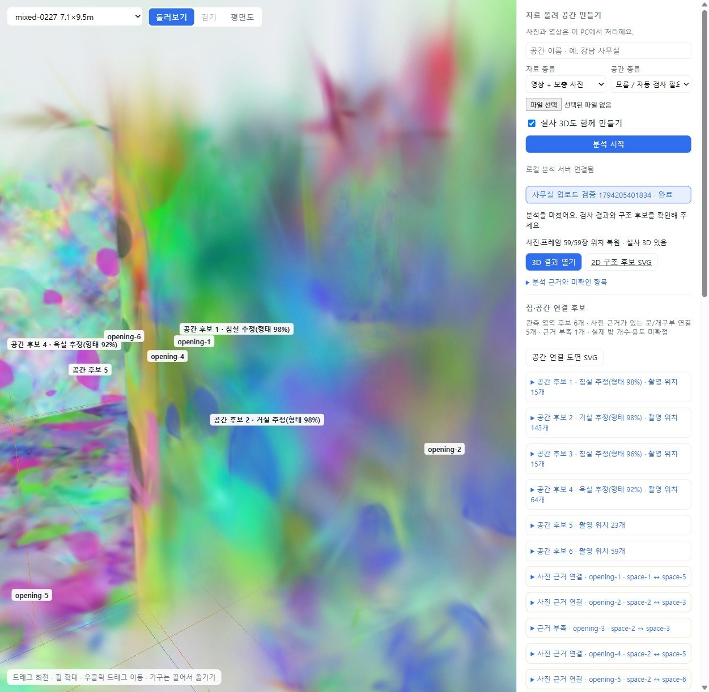
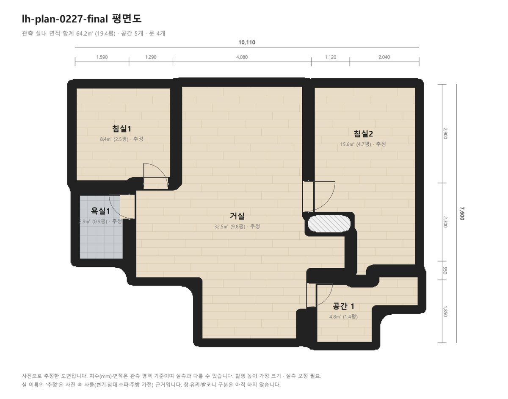
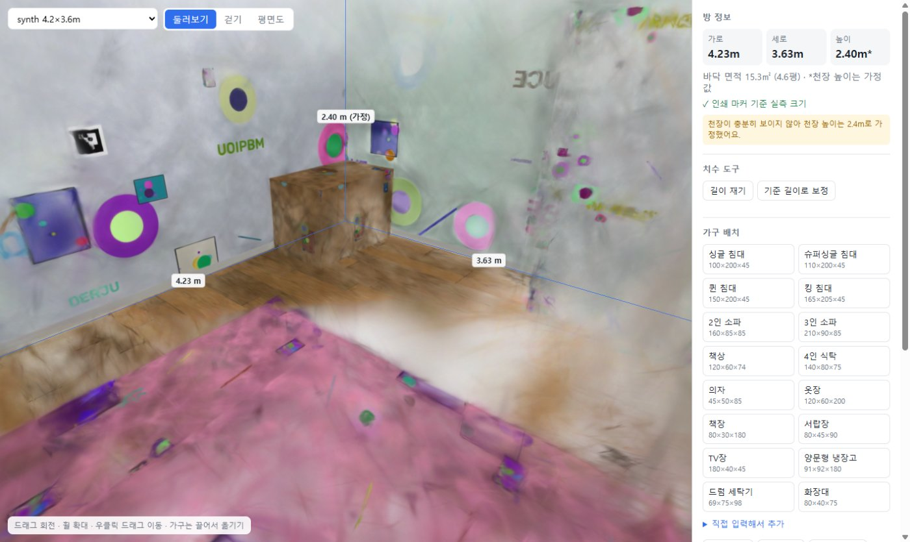
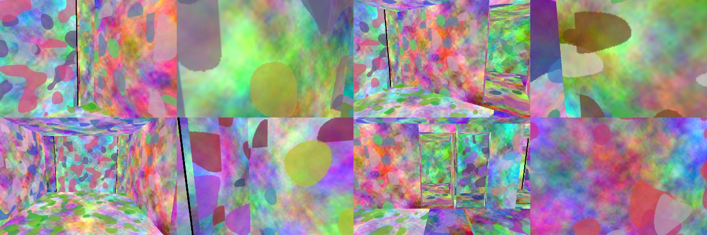
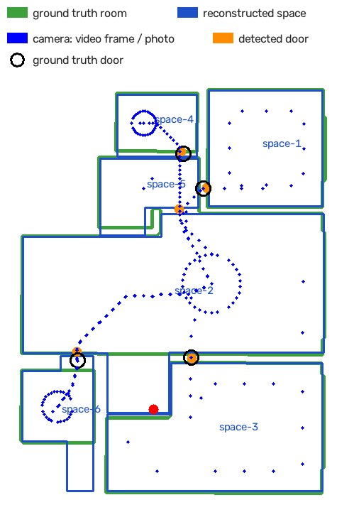
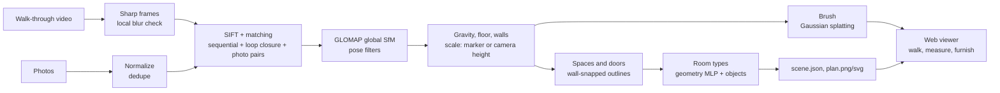

<div align="center">

# spaceCapture

**Walk through a home with your phone — get a measurable 3D space and a 2D floor plan.**

**English** · [한국어](README.ko.md) · [简体中文](README.zh-CN.md) · [日本語](README.ja.md) · [Español](README.es.md)

</div>

> [!IMPORTANT]
> **Research prototype.** All accuracy numbers below come from synthetic renders of real Korean public-housing floor plans and a synthetic room video, reconstructed with the real pipeline. **It has not yet been validated on real listing photos or real phone videos.** Treat outputs as review candidates, not certified floor plans.



## What it does

Like a car that builds a 3D picture of its surroundings from its cameras, spaceCapture turns **what you film indoors** into a 3D space you can walk through, measure, and furnish. Everything runs **locally on a regular PC (no CUDA, no hosted AI APIs)** and uses only commercially usable open-source components.

- **Three ways to capture**: a walk-through **video**, a set of overlapping **photos**, or **video + supplementary photos** for rooms or corners the video missed. All are reconstructed into one coordinate system.
- **Camera poses and sparse 3D** with COLMAP/GLOMAP on CPU, with automatic focal-length convergence and filters for wrongly registered frames.
- **Real-world scale** from a printed ArUco marker, or an assumed camera height (1.45 m) that you can correct with any known length in the viewer.
- **Rooms and doors**: splits the observed floor into spaces, finds doorways between them, and snaps each space outline to the observed walls.
- **Room types**: estimates living room / bedroom / bathroom from shape and connectivity (a small neural network trained here), and prefers object evidence (toilet, bed, sofa, kitchen appliances detected with YOLOX) when available.
- **Photorealistic 3D** with Gaussian splatting (Brush, runs on AMD/Intel GPUs via WebGPU).
- **Korean real-estate style 2D plan** (`plan.png` / `plan.svg`): black walls, wood/tile floors, door swings, mm dimension chains, ㎡ and 평.
- **Web viewer**: orbit / walk / plan modes, two-point measurement, scale calibration, 16 furniture presets with wall snapping and collision checks.

<table>
<tr>
<td width="50%"><br><sub>Generated 2D plan (spaces, doors, areas, estimated room names)</sub></td>
<td width="50%"><br><sub>Gaussian-splat room with measured dimensions and furniture tools</sub></td>
</tr>
<tr>
<td><br><sub>Frames from a synthetic whole-home walk-through video (test input)</sub></td>
<td><br><sub>Video + photos reconstruction vs ground truth: spaces, doors, cameras</sub></td>
</tr>
</table>

## How it works



## Results so far (synthetic data)

| Test | Result |
|---|---|
| Single room video with marker (4.2 × 3.6 m) | width/depth error **+2.8 / +3.1 cm**, camera trajectory RMSE ≈ 0.2 cm |
| Whole-home walk-through video (162 s, 5 rooms) | **465 / 469** frames registered, camera error 0.39 cm |
| Video (3 rooms) + 42 photos (other 2 rooms) | **319 / 323** registered, all 42 photos in the same frame, camera error **0.16 cm**, room IoU 0.733 |
| Photo sets of 26 unseen houses (LH floor-plan structures) | mean room IoU **0.833**, door recall / precision **0.85 / 0.87** |
| Room type (living / bedroom / bathroom / other), 90 spaces | **84 %** accuracy; **92 %** on the 73 % of spaces it labels |
| Indoor object detection (YOLOX-s, COCO indoor subset) | mAP50 0.649; on a real office video (TUM RGB-D) 36/41 objects within 1 m, median 7.3 cm |

Known gaps: not real-time (7–11 min per home on a laptop CPU). Ceiling height is usually assumed (2.4 m) unless the ceiling is well observed. Bathroom vs. dressing/utility room is the most common room-type error. Real listing photos are usually 5–20 non-overlapping shots, which is not enough for reconstruction. Details: [AGENTS.md](AGENTS.md) and [docs/](docs).

## Quick start (Windows)

```powershell
python -m venv .venv
.\.venv\Scripts\python.exe -m pip install -r requirements.txt
.\.venv\Scripts\python.exe tools\fetch-binaries.py      # Brush v0.3.0 + YOLOX-s, hash-verified
cd viewer; npm install; npm run build; cd ..

.\.venv\Scripts\python.exe -m spacecapture serve       # http://127.0.0.1:8765
```

Open the web app, choose **video**, **photos**, or **video + extra photos**, and start the analysis. Files stay on your PC.

CLI:

```powershell
# walk-through video, optionally with extra photos
.\.venv\Scripts\python.exe -m spacecapture process home.mp4 --photos extra_photos --max-frames 400
# photos only
.\.venv\Scripts\python.exe -m spacecapture photos listing_photos --name listing
# re-analyse an existing scene without re-running SfM
.\.venv\Scripts\python.exe -m spacecapture inspect listing
# print a 150 mm ArUco marker for real scale
.\.venv\Scripts\python.exe -m spacecapture marker
# self-test with a synthetic room of known size
.\.venv\Scripts\python.exe -m spacecapture synth
.\.venv\Scripts\python.exe -m spacecapture process samples\synth_room.mp4 --name synth
.\.venv\Scripts\python.exe -m spacecapture evaluate synth
```

Tests: `.\.venv\Scripts\python.exe -m unittest discover -s tests`

Requirements: Python 3.14, Node 24, any GPU with WebGPU for Brush (CPU-only works with `--no-splat`). Developed on Windows 11 with an AMD Radeon 780M iGPU.

## Capture tips

- Walk slowly. Avoid spinning in place. Keep the floor–wall line visible.
- In each room, circle once while looking at the walls. Walk through doorways so both sides overlap.
- Missed a corner or a small room? Add a few overlapping photos and upload them together with the video.
- For true scale, stick the printed marker on a wall and film it from several angles for 2–3 seconds.

## Project layout

```
spacecapture/   Python pipeline (CLI: python -m spacecapture)
viewer/         Web viewer (Vite + three.js + Spark)
tools/          training, evaluation and data-preparation scripts
models/         small trained models (NumPy MLPs) + YOLOX metadata
tests/          unit tests
docs/           design notes and evaluation reports (mostly Korean)
AGENTS.md       detailed engineering hand-off (Korean)
```

## Licenses and data

- Components: COLMAP/GLOMAP (BSD), OpenCV (Apache-2.0), Brush (Apache-2.0), YOLOX (Apache-2.0), three.js and Spark (MIT). Non-commercial models and datasets are deliberately excluded.
- Trained weights in `models/`:
  - The ceiling model learned from ProcTHOR (Apache-2.0) structures.
  - The space, door-merge and room-type models learned from renders of LH public floor plans (data.go.kr, no usage restriction stated, copyright-cleared flag "N").
  - Check with the provider before commercial training. See [models/NOTICE.txt](models/NOTICE.txt).
- Third-party datasets, rendered scenes and experiment artifacts are **not** included in this repository.
- The license for this project's own code has not been chosen yet. All rights reserved until a license is added.

## Roadmap

- Test with real phone videos (white walls, exposure changes, motion blur) and fix what breaks.
- Faster processing and a live preview while filming.
- Ceiling height input or estimation. Separate kitchen detection.
- Glass and mirror awareness. Multi-floor homes.

Issues and ideas are welcome.
