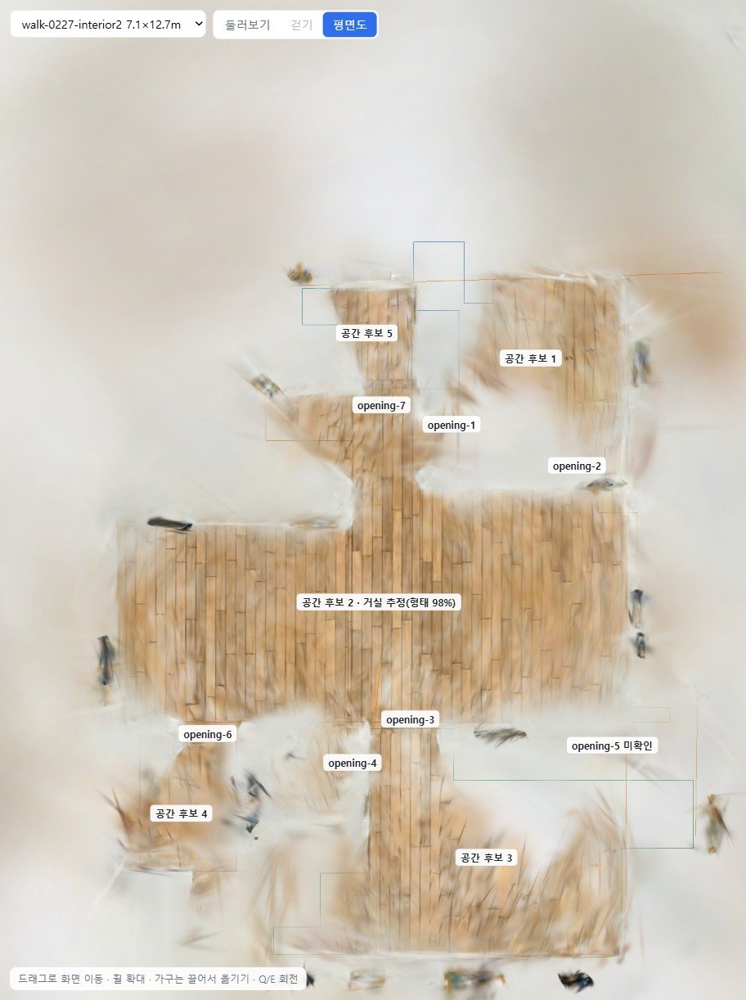
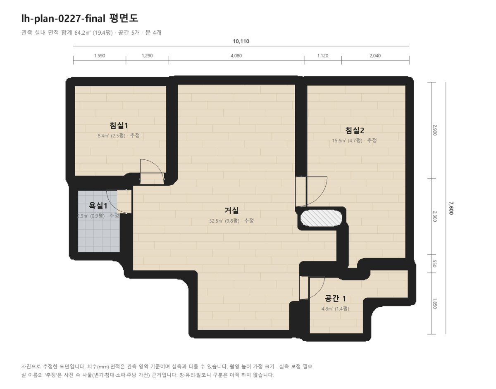
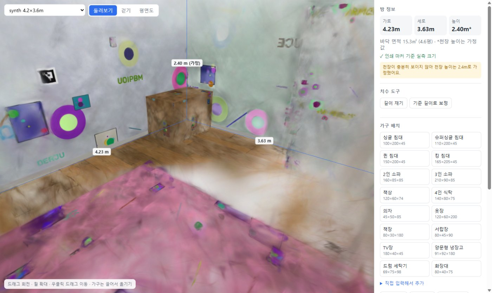
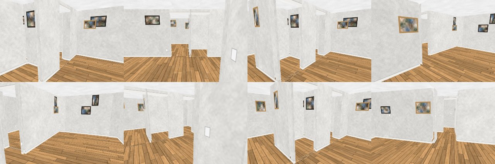
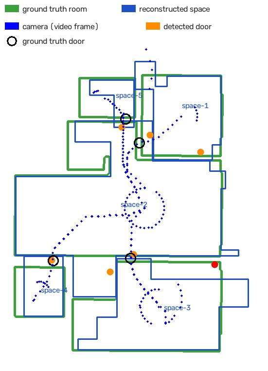
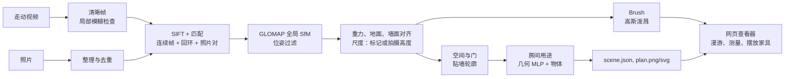

<div align="center">

# spaceCapture

**用手机边走边拍房间 —— 得到可测量的 3D 空间和 2D 平面图。**

[English](README.md) · [한국어](README.ko.md) · **简体中文** · [日本語](README.ja.md) · [Español](README.es.md)

</div>

> [!IMPORTANT]
> **研究原型。** 下列精度数据来自对韩国 LH 公共住房真实平面图结构自行渲染的合成照片和视频，以及一段合成房间视频。它们都经过真实流水线重建。**尚未在真实房源照片或真实手机视频上验证。** 输出结果仅供审阅参考，不是正式平面图。



## 功能

就像汽车用摄像头构建周围环境的 3D 画面一样，spaceCapture 把**在室内拍摄的视频和照片**变成可以漫游、测量和摆放家具的 3D 空间。所有处理都在**普通电脑上本地运行**（无需 CUDA，不调用外部 AI API），并且只使用可商用的开源组件。

- **三种输入方式**：边走边拍的**视频**、相互重叠的多张**照片**，或**视频 + 补充照片**。视频漏拍的房间或角落可以用照片补上，所有内容都会重建到同一个坐标系中。
- **相机位姿与稀疏 3D**：在 CPU 上运行 COLMAP/GLOMAP，自动收敛焦距，并过滤注册错误的帧。
- **真实尺度**：使用打印的 ArUco 标记确定尺度。没有标记时假设拍摄高度为 1.45 m，之后可在查看器中用任意已知长度校正。
- **房间与门**：把观测到的地面分割成各个空间，找出空间之间的门洞，并把空间轮廓贴合到观测到的墙面。
- **房间用途**：根据形状和连通关系估计客厅、卧室和卫生间（使用在本项目中训练的小型神经网络）。如果 YOLOX 检测到马桶、床、沙发或厨房电器等物体，会优先采用这些证据。
- **照片级 3D**：使用 Brush 进行高斯泼溅（Gaussian Splatting），通过 WebGPU 支持 AMD/Intel 显卡。
- **韩国房产风格 2D 平面图**（`plan.png` / `plan.svg`）：黑色墙体、木地板/瓷砖、开门弧线、毫米尺寸链，以及 ㎡ 和 坪（평）。
- **网页查看器**：环绕、漫游和平面图模式，两点测量，尺度校正，16 种家具预设（贴墙吸附、碰撞检查）。

<table>
<tr>
<td width="50%"><br><sub>生成的 2D 平面图（空间、门、面积、估计的房间名称）</sub></td>
<td width="50%"><br><sub>高斯泼溅房间，带测量尺寸和家具工具</sub></td>
</tr>
<tr>
<td><br><sub>白色墙纸、木地板的合成走动视频帧（测试输入）</sub></td>
<td><br><sub>走动视频重建结果与真值对比：空间、门、相机路径</sub></td>
</tr>
</table>

## 工作原理



## 目前结果（合成数据）

| 测试 | 结果 |
|---|---|
| 带标记的单个房间视频（4.2 × 3.6 m） | 长宽误差 **+2.8 / +3.1 cm**，相机轨迹 RMSE 约 0.2 cm |
| 全屋走动视频（162 秒，5 个房间） | **465 / 469** 帧完成注册，相机误差 0.39 cm |
| 同一住宅，逼真材质（少纹理白墙纸、木地板） | 空间 5 / 5，4 扇门全部找到，空间 IoU 0.687。纯墙面帧更难：位姿检查后 477 帧中保留 328 帧 |
| 视频（3 个房间）+ 42 张照片（另外 2 个房间） | **319 / 323** 张完成注册，42 张照片全部在同一坐标系，相机误差 **0.16 cm**，空间 IoU 0.733 |
| 26 套未参与训练的住宅照片集（LH 平面图结构） | 平均空间 IoU **0.833**，门召回率 / 精确率 **0.85 / 0.87** |
| 房间用途（客厅 / 卧室 / 卫生间 / 其他），90 个空间 | 准确率 **84%**；对其给出名称的 73% 空间，准确率为 **92%** |
| 室内物体检测（YOLOX-s，COCO 室内子集） | mAP50 0.649；真实办公室视频（TUM RGB-D）中 41 个物体有 36 个位置误差在 1 m 以内，中位数 7.3 cm |

已知不足如下，详见 [AGENTS.md](AGENTS.md) 和 [docs/](docs)（主要为韩文）。
- 不是实时处理：在笔记本 CPU 上每套住宅需要 7–11 分钟。
- 如果天花板观测不充分，层高按 2.4 m 假设。
- 房间用途最常见的错误是把卫生间与衣帽间、杂物间混淆。
- 真实房源照片通常只有 5–20 张且互不重叠，不足以完成重建。

## 快速开始（Windows）

```powershell
python -m venv .venv
.\.venv\Scripts\python.exe -m pip install -r requirements.txt
.\.venv\Scripts\python.exe tools\fetch-binaries.py      # Brush v0.3.0 + YOLOX-s，已校验哈希
cd viewer; npm install; npm run build; cd ..

.\.venv\Scripts\python.exe -m spacecapture serve       # http://127.0.0.1:8765
```

打开网页应用，选择**视频**、**照片**或**视频 + 补充照片**，然后开始分析。文件不会离开你的电脑。

命令行：

```powershell
# 走动视频，可附加补充照片
.\.venv\Scripts\python.exe -m spacecapture process home.mp4 --photos extra_photos --max-frames 400
# 仅照片
.\.venv\Scripts\python.exe -m spacecapture photos listing_photos --name listing
# 不重新运行 SfM，重新分析已有场景
.\.venv\Scripts\python.exe -m spacecapture inspect listing
# 打印 150 mm ArUco 标记以获得真实尺度
.\.venv\Scripts\python.exe -m spacecapture marker
# 用已知尺寸的合成房间自测
.\.venv\Scripts\python.exe -m spacecapture synth
.\.venv\Scripts\python.exe -m spacecapture process samples\synth_room.mp4 --name synth
.\.venv\Scripts\python.exe -m spacecapture evaluate synth
```

测试：`.\.venv\Scripts\python.exe -m unittest discover -s tests`

环境要求：Python 3.14、Node 24，以及支持 WebGPU 的显卡用于 Brush（没有显卡时可用 `--no-splat` 只走 CPU 流程）。开发环境为 Windows 11 + AMD Radeon 780M 集成显卡。

## 拍摄建议

- 慢慢走，少在原地转圈，让地面与墙面的交线保持在画面中。
- 每个房间看着墙壁绕一圈；走着穿过门口，让门两侧的画面有重叠。
- 漏拍了角落或小房间？补拍几张相互重叠的照片，和视频一起上传即可。
- 需要真实尺度时，把打印的标记贴在墙上，从多个角度各拍 2–3 秒。

## 目录结构

```
spacecapture/   Python 流水线（命令行：python -m spacecapture）
viewer/         网页查看器（Vite + three.js + Spark）
tools/          训练、评估和数据准备脚本
models/         本项目训练的小模型（NumPy MLP）+ YOLOX 信息
tests/          单元测试
docs/           设计记录与评估报告（主要为韩文）
AGENTS.md       详细的工程交接文档（韩文）
```

## 许可与数据

- 组件：COLMAP/GLOMAP（BSD）、OpenCV（Apache-2.0）、Brush（Apache-2.0）、YOLOX（Apache-2.0）、three.js 与 Spark（MIT）。刻意排除了非商用模型和数据集。
- `models/` 中的训练权重：
  - 天花板模型使用 ProcTHOR（Apache-2.0）结构训练。
  - 空间、门合并和房间用途模型使用 LH 公共平面图（韩国公共数据门户 data.go.kr，未标注使用限制，版权确认标记为 "N"）的渲染数据训练。
  - 商业训练或使用前请先向数据提供方确认，详见 [models/NOTICE.txt](models/NOTICE.txt)。
- 本仓库**不包含**第三方数据集原件、渲染场景和实验记录。
- 本项目代码采用 [MIT 许可证](LICENSE)。第三方组件以及 `models/` 中训练权重的数据说明遵循各自的条款。

## 路线图

- 用真实手机视频（白墙、曝光变化、运动模糊）测试，并修复出现的问题。
- 加快处理速度，并在拍摄时提供实时预览。
- 支持输入或估计层高，单独识别厨房。
- 识别玻璃和镜面，支持多层住宅。

欢迎提交 Issue 和想法。
