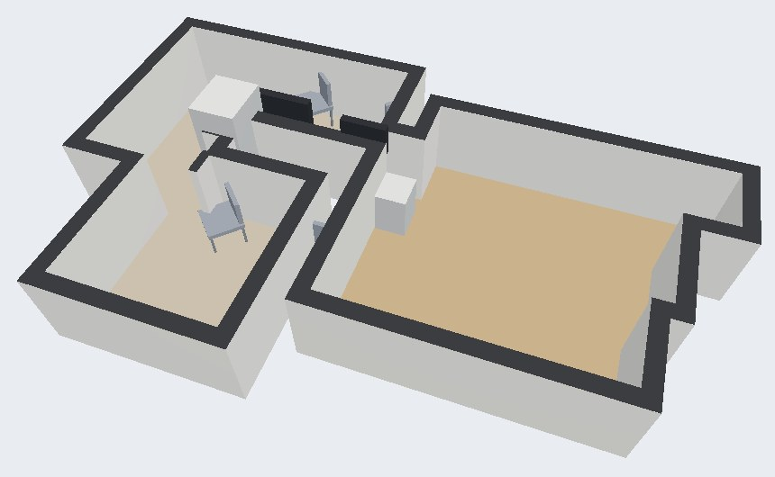

# 실내 사물 인식과 3D 위치 (2026-11-10)

사진 속 실내 사물을 검출하고, SfM 3D 점으로 사물의 3D 위치를 추정해 `scene.json`의 `objects`에 기록한다. 공간마다 **강한 사물 근거가 있을 때만** 용도 후보(욕실·침실·거실·주방)를 붙인다. 용도를 확정하지 않는다.

## 모델

- [YOLOX-s](https://github.com/Megvii-BaseDetection/YOLOX) 공식 ONNX 가중치(Apache-2.0), `models/yolox_s.onnx`, SHA-256 `c5c2d13e…`, 35,858,002바이트. 라이선스는 `models/LICENSE.yolox`. 공식 릴리스에서 받는 데 4.5초가 걸렸다.
- COCO 2017 train으로 학습된 공개 가중치다(주석 CC BY 4.0, 이미지는 Flickr 개별 라이선스). 이 프로젝트에서 재학습하지 않았다. Ultralytics YOLO(AGPL)는 라이선스 조건 때문에 쓰지 않았다.
- OpenCV DNN CPU 추론. 640×640 입력, 사진 1장당 약 **0.07초**. onnxruntime·torch를 추가하지 않았다.

## 검출 정확도 (COCO val2017, 상업 이용 가능 라이선스 실내 이미지 138장)

공개 가중치의 학습 분할과 겹치지 않는 표준 검증 분할 중 CC BY·CC BY-SA·저작권 제한 없음 이미지이면서 실내 주요 사물이 2종 이상인 이미지만 골랐다(평가 전용, 21.4MB). 실내 12종 **mAP50 0.649**, 10.2초.

| 사물 | 정답 상자 | AP50 |
|---|---:|---:|
| 침대 | 14 | 0.694 |
| 변기 | 21 | 0.771 |
| 소파 | 37 | 0.699 |
| TV·모니터 | 30 | 0.807 |
| 식탁·책상 | 115 | 0.464 |
| 오븐·레인지 | 23 | 0.608 |
| 냉장고 | 23 | 0.714 |
| 세면대·싱크대 | 44 | 0.477 |
| 전자레인지 | 8 | 0.871 |
| 의자 | 283 | 0.549 |
| 화분 | 25 | 0.461 |
| 노트북 | 24 | 0.673 |

해외 사진 기준이다. 국내 매물 사진(한국식 욕실·붙박이장·주방 구성)에서의 성능은 측정하지 않았다.

## 3D 위치와 사물 합치기

1. 사진별 검출 상자 안(가장자리 20% 제외)에 투영되는 그 사진의 관측 3D 점을 모은다.
2. 깊이가 앞쪽 25% 근처인 점만 남겨 뒤쪽 벽을 제외하고, 중앙값을 그 검출의 위치로 쓴다.
3. 같은 종류이고 가까운(기본 0.5m, 침대 1.2m·소파 1.0m 등) 검출을 한 사물로 합친다. **사진 2장 이상**에서 확인된 사물만 기록한다.

## 실제 영상 검증 (TUM RGB-D fr3/long_office_household, CC BY 4.0)

- 공식 tgz 1,483,556,251바이트 / 272초. 2,585프레임 중 구간별로 가장 선명한 150장을 골라 `photos` 파이프라인에 넣었다. 깊이·정답 궤적은 추론에 전달하지 않았다.
- **150/150장 등록**, 초점거리 537px(실제 535.4px), SfM 176초, 사물 처리 11.1초. 카메라 궤적 정렬 RMSE 1.99cm. 촬영 높이 1.45m 가정 축척은 정답 대비 1.078배였다.
- 기준 위치: 같은 프레임의 깊이 영상과 정답 궤적으로 같은 방식(상자 앞쪽 점 중앙값)으로 계산했다. 같은 검출기를 쓰므로 검출 정확도가 아니라 **SfM 점으로 계산한 3D 위치**를 평가한다. 평가 때만 카메라 궤적으로 좌표·배율을 맞췄다.
- 우리 사물 41개 중 **36개가 같은 종류 1m 이내로 대응**, 위치 오차 **중앙값 7.3cm / 평균 14.9cm**. 병·컵·키보드·인형·마우스 등 작은 사물은 1.4~6.9cm, 의자·모니터는 13~27cm, 오차가 큰 사례는 병 78cm·노트북 69cm였다. 깊이 기준 사물 44개 중 8개는 대응하지 못했다.

## 용도 후보 규칙과 알려진 오검출

TUM 사무실 영상에서 칸막이 수납장→냉장고(7장, 0.81), 접시→싱크대(5장, 0.66), 모니터→TV, 책상→식탁 오검출을 확인했다. 이 결과를 보고 규칙을 정했으므로 **규칙 자체는 독립 검증되지 않았다**.

- 강한 근거: 사진 3장 이상, 점수 0.6 이상
- 욕실 후보: 변기 / 침실 후보: 침대 / 거실 후보: 소파
- 주방 후보: 서로 다른 주방 가전 2종(냉장고·오븐·전자레인지·싱크대), 각각 점수 0.7 이상
- TV(모니터 혼동)와 식탁(책상 혼동)은 용도 근거로 쓰지 않는다.

TUM 사무실 장면은 이 규칙으로 용도 후보 0개다(사무실은 분류 대상 용도가 아니다). 실제 주택의 여러 사진으로 욕실·침실 후보가 맞게 붙는지는 아직 검증하지 못했다(자체 렌더 사진에는 가구가 없다).

## 재현

```powershell
.\.venv\Scripts\python.exe -X utf8 tools/fetch-coco-indoor.py
.\.venv\Scripts\python.exe -X utf8 tools/evaluate-object-detector.py
.\.venv\Scripts\python.exe -X utf8 tools/validate-objects-tum.py          # samples/external/tum-rgbd 필요
```

증거: `artifacts/object-detection/coco-indoor.json`, `artifacts/object-validation/tum-long-office.json`, 장면 `scenes/tum-long-office`.


## 가구 크기·방향 상자 (2026-11-27)



사물마다 여러 사진의 검출 상자에 맞는 3D 상자를 푼다(`spacecapture/object_boxes.py`). 상자 8꼭짓점을 각 사진에 투영한 외곽 사각형과 검출 상자의 변 차이(상자 대각선 대비, Huber)를 줄이고, 종류별 일반 크기를 약하게 당긴다. 바닥 접지·벽 축 방향(의자 45° 포함)을 가정한다.

| 검사 | 결과 |
|---|---|
| 가상 카메라 6대(침대 1.6×2.0×0.55m, 90° 회전, 2px 잡음) | 크기 ±12cm 이내, 방향 일치 |
| TUM 실제 사무실 150장 | 13개 맞춤, 표시 8개(의자 5·모니터 2·중복 2개 제거·주방 근거 없는 냉장고/오븐 숨김) |
| 윗면 높이 vs 깊이 카메라 | 중앙값 오차 6.7cm(이후 Hypersim 조정 뒤 9.1cm) |
| 무늬 바닥을 침대로 잘못 본 합성 장면 | 바닥 보임 47~100% → 모두 제외 |

가로·깊이의 깊이 카메라 기준은 상자 주변 0.3m의 점을 포함해 크게 잡히므로(책상·벽 포함) 참고값이다. 실제 주택 가구로는 아직 검증하지 않았다.


## Hypersim 사실적 렌더 집으로 검증 (2026-11-27)

Apple Hypersim(데이터 CC BY-SA 3.0)은 가구가 있는 사실적 렌더 집과 사물별 정답 3D 상자·카메라를 준다. 평가 전용으로 쓰고 저장소에 넣지 않는다. 장면 ZIP에서 필요한 파일만 HTTP Range로 받는다(장면당 약 7MB).

- 추론: 장면당 사진 100장을 정답 없이 `photos`로 복원 → 사물 검출 → 상자 맞춤.
- 평가: 우리 카메라를 정답 카메라에 닮음 변환으로 맞춘 뒤(배율 오차 제거), 같은 종류·바닥 중심 1m 이내로 대응. 카메라 정렬 오차 10cm 초과 장면은 복원 실패로 제외.
- 조정은 개발 8곳에서만 했다(계열 중복 합치기, 검출 재대응, 최소 사진 8장). 시험 15곳은 조정 뒤 한 번만 평가했다.

| 시험 15곳(정렬 통과 9곳) | 조정 전 | 조정 후 |
|---|---:|---:|
| 표시한 상자 | 79 | 52 |
| 정밀도(표시 중 정답 대응) | 0.38 | **0.48** |
| 재현율(보이는 정답 가구 73개) | 0.41 | 0.34 |
| 일반 크기 가구 15개: 가로·깊이 / 높이 / 방향 | – | **11.4 / 7.4cm / 3.3°** |

정답 쪽 정의 차이(폭 1.5m 라운지 의자를 chair로, 침대 높이에 머리판 포함, 책상 세트 하나로)인 10개는 가로 오차 57cm다. 실제 주택 촬영 검증은 아직 없다.

### 2차 조정 (2026-11-27)

상자 안에 SfM 점이 하나도 없으면 믿지 않고(허상 TV 등), 같은 계열 중심이 큰 쪽 가로의 절반보다 가까우면 중복으로 합치며, 최소 사진 수를 6장으로 바꿨다. 시험 9곳: 정밀도 0.48→0.53, 재현율 0.34→0.37, 일반 크기 가구 가로·깊이 10.4/11.4cm, 높이 7.5cm, 방향 3.3°. TUM 실제 사무실 윗면 높이 중앙값 오차는 현재 9.1cm다.
